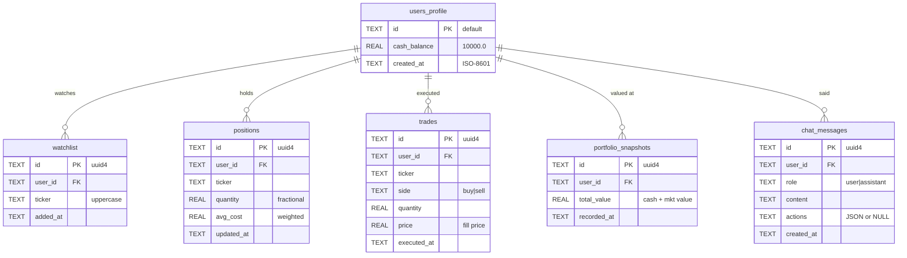
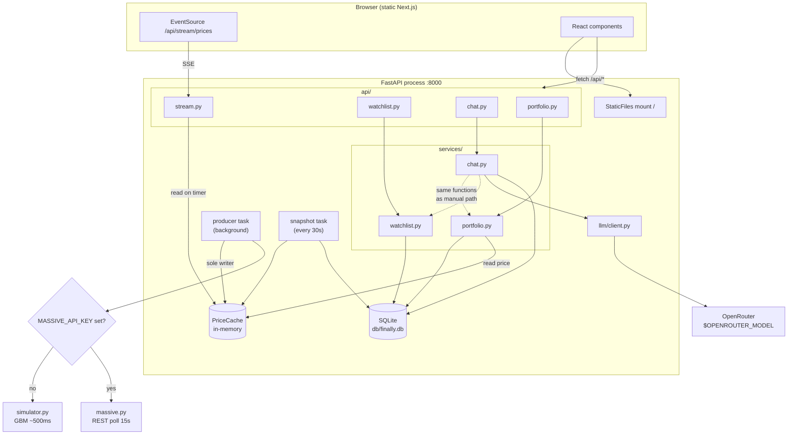
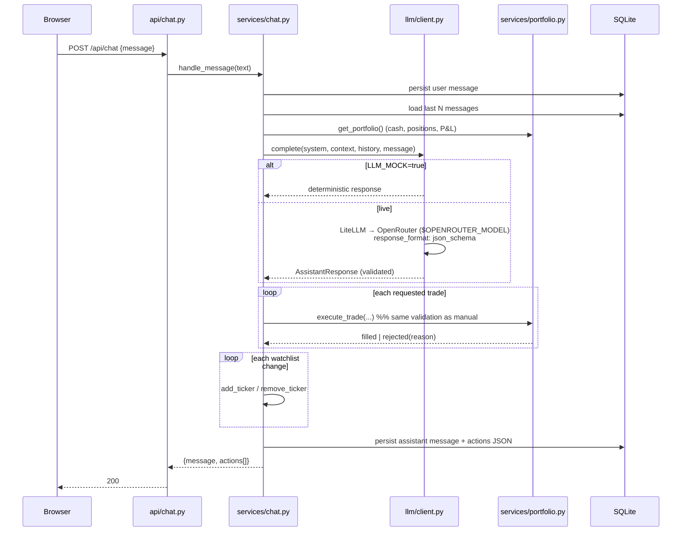

# Design: FinAlly — AI Trading Workstation

Upstream spec: `SPEC.md` (repo root — user-authored, consumed in place of a `define` run)

## Overview

FinAlly is **one process serving one port**. A FastAPI app owns everything server-side;
a statically-exported Next.js bundle is mounted underneath it as the catch-all route.
There is no service mesh, no message broker, no separate frontend server — the whole
system is a single container whose only external dependencies are OpenRouter (optional
at runtime) and Massive (optional entirely).

The runtime has three concurrent concerns, and the design keeps them strictly separated:

1. **A price producer** — exactly one background task, chosen at startup by
   environment variable, writing into an in-memory cache. It is the *only* writer.
2. **Request/response state** — SQLite, read and written synchronously inside request
   handlers. Cash, positions, trades, watchlist, chat history.
3. **A fan-out reader** — the SSE endpoint, which reads the cache on a timer and
   pushes to every connected client. It never writes anything.

That split is the spine of the design. Prices are *ephemeral and shared* (memory);
portfolio state is *durable and owned* (SQLite). Nothing writes prices to the database,
and nothing reads prices from it. Every derived number the UI shows — position market
value, unrealized P&L, total portfolio value — is computed at read time by joining a
durable position row against the ephemeral cache. There is no stored `current_price`
column anywhere, because a stored one would immediately be stale.

The request path for the two interesting operations:

**A manual trade** (`POST /api/portfolio/trade`) reads the price from the cache,
validates against cash or share count, and applies a position mutation plus a trade-log
append plus a portfolio snapshot in **one SQLite transaction**. Validation failure means
nothing is written and a 4xx comes back.

**A chat message** (`POST /api/chat`) assembles portfolio context, calls the LLM for a
structured response, and then feeds each requested trade and watchlist change through
*the exact same service functions the manual endpoints call*. The LLM never gets a
privileged path into the database. A trade the LLM asks for that fails validation
produces an error recorded in the response's actions list — the chat call still returns
200, because the assistant successfully answered; it merely could not do one of the
things it wanted.

The frontend is a thin projection. It holds one `EventSource`, keeps a bounded in-memory
ring of recent prices per ticker (this is what the sparklines draw — the spec is explicit
that sparklines accumulate client-side since page load, so there is no price-history
table and no price-history endpoint), and refetches portfolio/watchlist snapshots after
mutations. Live price changes drive the DOM directly from the SSE stream, not from
refetching.

## Data model

The schema is exactly the spec's six tables. `user_id` is present on every table,
hardcoded to `"default"`, so multi-user is a later change to *queries*, not to *tables*.



Constraints and indexes beyond the spec's `UNIQUE (user_id, ticker)` on `watchlist` and
`positions`:

| Object | Why |
| --- | --- |
| `CHECK (side IN ('buy','sell'))` on `trades` | The one enum the DB can cheaply defend; keeps a malformed LLM action from poisoning the history log even if service validation is ever bypassed. |
| `CHECK (role IN ('user','assistant'))` on `chat_messages` | Same reasoning; the chat history render branches on this value. |
| `INDEX (user_id, recorded_at)` on `portfolio_snapshots` | The P&L chart is a range scan ordered by time, and this table grows unbounded (one row per 30 s plus one per trade). It is the only table with a growth rate. |
| `INDEX (user_id, created_at)` on `chat_messages` | Every chat turn reads the most recent N messages in reverse-chronological order. |

`trades` gets no index: it is append-only and nothing in the MVP queries it. Adding one
would be speculative.

**In-memory price cache** (not persisted, not a table):

```python
Quote = TypedDict("Quote", {
    "ticker": str,
    "price": float,
    "previous_price": float,   # the immediately preceding tick — drives the flash
    "session_open": float,     # first price seen this process lifetime — drives change %
    "timestamp": str,          # ISO-8601 UTC
    "direction": str,          # "up" | "down" | "flat"
})
# cache: dict[str, Quote]. The producer builds a new dict and rebinds it;
# readers take the current reference. No lock — see below.
```

`direction` is derived by the producer at write time rather than by each SSE reader, so
every client sees the same direction for the same tick.

**`previous_price` and `session_open` are two different things, and conflating them is
the trap here.** `previous_price` is the last tick and has one job: deciding whether the
row flashes green or red. The watchlist's **daily change %** (spec §2, §10) must come from
`session_open` instead — a 500 ms delta renders as ±0.01% and flips sign every tick, which
is not a "daily change" by any reading. `session_open` is stamped once, by the producer,
the first time a ticker enters the cache, and never rewritten while the process lives.
Change % is `(price − session_open) / session_open`, and it reads `0.00%` for the first
tick after a ticker is added, which is honest.

The cache needs **no lock**. This is single-threaded asyncio: the producer assembles a new
dict and rebinds the module-level reference in one bytecode step, so no reader can observe
a half-applied update, and readers hold an immutable snapshot for as long as they need it.
A lock here would be ceremony — and worse, it would create the "never hold it across a
socket write" rule that the ceremony then requires. (If DB work later moves to a
threadpool, revisit: `services/` never touches the cache from a thread today.)

### Numeric representation

Money is `float` (REAL) throughout, matching the spec's schema. This is a deliberate
accepted inaccuracy for a simulated portfolio — see `decisions.md` D8. The one place it
is defended: `avg_cost` recomputation and cash arithmetic round to 4 decimal places
before write, and the "sell everything" path compares with a tolerance
(`quantity <= 1e-9` deletes the row) so accumulated float dust cannot leave a phantom
position of 0.0000000001 shares in the positions table.

## Module & component design

### Backend

```
backend/
├── pyproject.toml           # uv project, Python 3.12
└── src/finally_app/
    ├── main.py              # app factory, lifespan, static mount, router include
    ├── config.py            # Settings: env → frozen dataclass, read once
    ├── db/
    │   ├── schema.sql       # CREATE TABLE IF NOT EXISTS … (the literal DDL)
    │   ├── connection.py    # connect(), transaction() contextmanager, row factory
    │   └── init.py          # ensure_initialized(): DDL + seed, idempotent
    ├── market/
    │   ├── source.py        # MarketDataSource Protocol + Quote type
    │   ├── simulator.py     # GBM simulator
    │   ├── massive.py       # Massive REST poller
    │   ├── cache.py         # PriceCache: the single shared in-memory store
    │   └── producer.py      # the background task that drives a source into the cache
    ├── services/            # all business logic; no FastAPI imports here
    │   ├── portfolio.py     # execute_trade, get_portfolio, snapshot
    │   ├── watchlist.py     # add_ticker, remove_ticker, list_watchlist
    │   └── chat.py          # orchestration: context → llm → apply actions → persist
    ├── llm/
    │   ├── schema.py        # Pydantic models for the structured response
    │   ├── client.py        # LiteLLM → OpenRouter, structured outputs, tolerant parsing
    │   └── mock.py          # deterministic responses for LLM_MOCK=true
    └── api/
        ├── portfolio.py     # /api/portfolio*
        ├── watchlist.py     # /api/watchlist*
        ├── chat.py          # /api/chat, /api/chat/messages
        ├── stream.py        # /api/stream/prices
        └── system.py        # /api/health
```

The layering rule is one sentence: **`api/` translates HTTP, `services/` owns business
rules, `db/` owns SQL, and `market/` and `llm/` are the two external-world adapters.**
`services/` imports from `db/`, `market/`, and `llm/` — never the reverse, and never
FastAPI. That is what makes the trade logic testable without a running server, and it is
what makes "the LLM path and the manual path share validation" structurally true rather
than a convention someone has to remember.

Per the style profile, these are **modules of functions**, not classes. The three places
a class earns its keep: `PriceCache` (real mutable state, rebound atomically rather than locked), the Pydantic
response models (validation protocol), and `Settings` (a frozen value object).
`MarketDataSource` is a `typing.Protocol`, not an ABC — the two implementations are
structurally checked at type-check time and never need a shared base at runtime.



#### Database access in an async process

The stdlib `sqlite3` driver is **blocking**, and three different async contexts touch the
database: request handlers, the producer (re-reading the ticker universe each tick), and
the snapshot task. Left on the event loop, one slow write would stall every SSE generator
and the producer along with it. So:

- **`services/` functions are ordinary synchronous `def` functions.** They open a
  connection, do their work in a transaction, and close it. No `async` anywhere in the
  business layer — which is also what makes them trivially unit-testable.
- **Route handlers are declared `def`, not `async def`.** Starlette runs a sync handler on
  its threadpool automatically, so the event loop stays free with no wrapper code. This is
  the whole reason the layering rule forbids FastAPI imports in `services/`: the layer has
  no opinion about who calls it.
- **Background tasks call into `services/` via `asyncio.to_thread`.** The producer and the
  snapshot task are `async` (they own timers), so they hop to a thread for their DB reads
  and writes explicitly.
- **One connection per call, never shared.** `sqlite3` connections are not safe across
  threads, and with handlers on a threadpool there genuinely are multiple threads. A
  connection-per-call against a local file costs microseconds; `check_same_thread=False`
  plus a shared connection would trade that for a real correctness hazard.

This is what gives `BEGIN IMMEDIATE` something to do: with several threads able to hold
their own connections, two trades really can be in flight, and the second blocks until the
first commits and then reads the updated cash balance. `PRAGMA journal_mode=WAL` is set at
init so a long read never blocks a write.

#### Configuration

`config.py` reads the environment **once** at startup into a frozen `Settings` dataclass,
and every module takes `Settings` as a parameter rather than reaching for `os.environ`.
That is what makes the whole backend testable without monkeypatching the environment.

| Variable | Required | Effect |
| --- | --- | --- |
| `OPENROUTER_API_KEY` | for chat | Passed to LiteLLM as `api_key`. Absent → chat 503s, everything else works. |
| `OPENROUTER_MODEL` | for chat | The model id sent to OpenRouter, verbatim. No baked-in default. |
| `MASSIVE_API_KEY` | no | Set and non-empty → Massive poller; absent or empty → simulator. |
| `MASSIVE_POLL_SECONDS` | no | Poll interval, default `15` (the free tier's 5 calls/min ceiling). Spec §6 calls the interval configurable and gives paid tiers 2–15 s; without this variable a paying user cannot use the tier they bought. |
| `LLM_MOCK` | no | `true` → `llm/mock.py` replaces the client entirely. Default `false`. |

`OPENROUTER_MODEL` is an addition to the spec's §5 table — see `decisions.md` D9.
Validation is **fail-soft, not fail-fast**: missing LLM variables do not stop the process,
because a user who only wants to watch prices and trade should not be blocked by a
missing API key. The two market-data and chat subsystems degrade independently.

#### Lifespan

`main.py` uses a FastAPI `lifespan` context manager to start and stop the two background
tasks. **Startup order matters**: `ensure_initialized()` runs first (the producer needs
the watchlist to know which tickers to price), then the producer task, then the snapshot
task. On shutdown both tasks are cancelled and awaited so `uvicorn` exits cleanly rather
than after a timeout.

The spec says the DB initializes "on startup (or first request)". This design does it in
lifespan startup, not lazily per request: a lazy check would need a lock on every request
to avoid two concurrent first-requests racing the DDL, and it would leave the producer
with no ticker list at boot. Idempotent DDL at a known point is simpler than a guarded
check on the hot path.

#### The price producer and cache

One `asyncio.Task` runs a loop. Each iteration: ask the source for quotes for the current
ticker universe, write them into the cache, sleep the source's interval. The **ticker
universe** is the union of the watchlist and any ticker with an open position — a
position in a ticker you have removed from the watchlist still needs a price, or its
market value silently becomes stale. The universe is re-read from SQLite each iteration
(a trivial query against a table of ~10 rows), which is how an `add_ticker` call gets
priced within one tick without any cross-task signalling.

The cache is a plain `dict[str, Quote]` rebound wholesale by the producer (see Data
model). Readers take the current reference and are free to be slow with it; a stalled SSE
client cannot stall the producer, because the producer never waits on anything a reader
holds.

Because everything is single-process asyncio, there is no cross-process cache-coherency
problem. That is a real constraint on horizontal scaling and is recorded under
Limitations, not papered over.

#### SSE endpoint

`GET /api/stream/prices` returns a `StreamingResponse` of `text/event-stream`. Its
generator loops: snapshot the cache, emit one `data:` line of JSON per changed ticker,
sleep ~500 ms. Three details that are easy to get wrong and are therefore design, not
implementation detail:

- **Only send what changed.** The producer stamps each quote with its own timestamp; the
  generator remembers the last timestamp it sent per ticker and skips unchanged ones.
  With the Massive source polling every 15 s, a naïve emit-everything loop would push 30
  identical frames per quote, and every one of them would trigger a price-flash animation
  on a price that did not move.
- **First frame is a full snapshot.** A client connecting mid-stream must not wait for
  the next tick of every ticker to render a price. The generator emits the entire cache
  once, then goes incremental.
- **Heartbeat.** A `: keepalive` comment every ~15 s keeps proxies and browsers from
  reaping an idle connection. Cheap insurance; without it a market with no movement looks
  identical to a dead backend.
- **Disconnect.** The generator wraps in `try/finally` and exits on
  `asyncio.CancelledError`; FastAPI cancels it when the client goes away. No client
  registry to leak.

#### Chat orchestration

`services/chat.py` is the only place where "agentic" behavior lives, and it is a
straight-line function, not a loop or an agent framework:



The `actions` array returned to the client and stored as JSON records *outcomes*, not
requests: `{"type":"trade","ticker":"AAPL","side":"buy","quantity":10,"status":"filled","price":190.12}`
or `{"type":"trade",...,"status":"rejected","reason":"insufficient cash"}`. The frontend
renders both inline; the rejected ones are how the user learns the assistant overreached.

The LLM sees a **rendered text context block**, not raw JSON dumps — cash, each position
with quantity/avg cost/current price/unrealized P&L, watchlist with live prices, and
total value. Prices come from the cache at request time, so the model reasons about the
same numbers the user is looking at.

**`GET /api/chat/messages`** — one endpoint beyond spec §8's table, returning the stored
conversation newest-last. Without it the panel is blank after every reload while the rows
sit in SQLite unreachable, which contradicts spec §10's "scrolling conversation history".
Recorded as D18.

**One-shot, no tool loop.** The model returns its trades in a single structured response
and the backend executes them. There is no second round-trip letting the model react to a
rejection. This is the spec's design (§9), it halves latency, and it removes an entire
class of runaway-loop failure. The cost — the model cannot retry a rejected trade with a
smaller size in the same turn — is accepted and recorded.

#### LLM client

`llm/client.py` makes **one** call, through LiteLLM, to OpenRouter:

```python
response = await litellm.acompletion(
    model=f"openrouter/{settings.openrouter_model}",   # OPENROUTER_MODEL, verbatim
    messages=messages,
    api_key=settings.openrouter_api_key,               # OPENROUTER_API_KEY
    response_format=ASSISTANT_RESPONSE_FORMAT,         # type: json_schema, strict
    temperature=0.4,
    timeout=60,
)
```

Three things are deliberate:

- **No provider routing.** The request names a model and nothing else; OpenRouter picks
  the backend. No `provider.order`, no `allow_fallbacks: false`. Pinning a specific
  inference provider buys latency at the cost of a hard failure whenever that one
  provider is down or drops the model, and it makes the model choice non-swappable from
  `.env` — which is exactly what `OPENROUTER_MODEL` exists to allow.
- **The model is configuration, not code.** `OPENROUTER_MODEL` is read once into
  `Settings` and passed through unmodified. No default model is baked into the source —
  a missing value is a startup-time configuration error, not a silent fallback to
  whatever the author happened to test with.
- **Structured outputs, not prompt-begging.** `response_format` carries the full
  `json_schema` for `AssistantResponse` with `strict: true` and
  `additionalProperties: false` on every object. The schema is the contract that lets the
  backend populate `trades[]` and `watchlist_changes[]` as typed fields instead of
  scraping prose.

The schema declared to OpenRouter and the Pydantic model in `llm/schema.py` are **one
definition, not two**: the JSON Schema is generated from the Pydantic models
(`model_json_schema()`) so the wire contract and the validation cannot drift apart.
`strict` mode requires every property listed in `required` and `additionalProperties:
false` throughout, so `trades` and `watchlist_changes` are declared required with an
empty array as the "nothing to do" value rather than being optional.

Structured-output support across OpenRouter's model catalogue is uneven — some backends
honour `json_schema`, some degrade to plain JSON, some emit a fenced block. Because the
model is user-configurable, the client cannot assume the best case: it validates with
Pydantic and falls back to the tolerant parse (strip fences → extract the outermost
`{…}` → validate) before giving up. Parsing is lenient; execution is not.

### Frontend

```
frontend/
├── next.config.ts               # output: 'export'
├── tailwind.config.ts           # dark theme tokens from spec §2
├── vitest.config.mts            # jsdom env; *.test.tsx colocated with components
└── src/
    ├── app/page.tsx             # the single page: layout grid only
    ├── components/
    │   ├── Header.tsx           # total value, cash, connection dot
    │   ├── Watchlist.tsx        # rows + flash + sparkline
    │   ├── Sparkline.tsx        # SVG polyline from the price ring
    │   ├── MainChart.tsx        # selected-ticker chart
    │   ├── Heatmap.tsx          # treemap of positions
    │   ├── PnlChart.tsx         # portfolio value over time
    │   ├── PositionsTable.tsx
    │   ├── TradeBar.tsx
    │   └── ChatPanel.tsx
    ├── hooks/
    │   ├── usePriceStream.ts    # THE EventSource — one instance, app-wide
    │   ├── usePortfolio.ts      # fetch + refetch-after-mutation
    │   └── useWatchlist.ts
    └── lib/
        ├── api.ts               # typed fetch wrappers for /api/*
        ├── format.ts            # money / percent / signed-change formatting
        └── types.ts             # shared response types
```

`usePriceStream` is the load-bearing piece. It owns exactly one `EventSource` for the
whole app (mounted at the page root, distributed by React context), and it maintains two
things: a `Map<ticker, Quote>` of current prices and a `Map<ticker, number[]>` **ring
buffer** for history. The cap is the design: without it, a tab left open for an hour
accumulates 7,200 points per ticker and the sparkline path grows until rendering stutters.

The buffer is **two-tier**, because the sparkline and the main chart want different
horizons and a single cap cannot serve both:

- **~120 points for every ticker** (~60 s at 500 ms) — all a 60-pixel-wide sparkline can
  resolve anyway.
- **~1,800 points for the currently selected ticker only** (~15 min) — otherwise the
  "larger detailed chart" of spec §10 draws the identical 60-second window as the tiny
  sparkline sitting next to it, which defeats the point of clicking a ticker.

Switching selection starts the long buffer over from the short one's contents, so the
main chart begins with the last 60 s and deepens as it runs. This is the direct cost of
D1's no-history-table choice and is recorded under Limitations.

Connection status comes from `EventSource.readyState` plus the `onerror` handler:
`OPEN` → green, `CONNECTING` after a prior open → yellow (reconnecting), repeated errors
→ red. `EventSource` reconnects natively; the design adds no retry logic of its own.

The **price flash** is CSS-only: on a new quote the row shows a `flash-up`/`flash-down`
element, and a timeout removes it after ~500 ms. No animation library, no per-frame React
state.

*Amended at CP11, from measurement.* The class sits on a keyed overlay **child** of the
row, not on the row itself. Setting the same class string again changes no DOM attribute,
so React bails out and the CSS animation does not restart — a ticker rising steadily at
500 ms would flash once and then go quiet while it kept rising. A keyed element mounts
fresh per move, which restarts the animation without an animation library and without
per-frame state, so every constraint above still holds.

**Rendering split** — this is the performance decision that keeps a 500 ms tick rate from
melting the UI:

- Price-driven pixels (watchlist rows, header total, positions table current price/P&L)
  subscribe to the stream context and re-render on tick.
- State-driven pixels (positions list membership, cash, watchlist membership, chat) come
  from fetched snapshots and re-render only after a mutation.

So a tick re-renders numbers, never structure.

### Packaging & delivery

The spec's §11 and §12 deliverables are components too, and they have owners.

```
Dockerfile                    # stage 1 node:20-slim → stage 2 python:3.12-slim
docker-compose.yml            # convenience wrapper: build, volume, --env-file
scripts/{start,stop}_mac.sh
scripts/{start,stop}_windows.ps1
db/.gitkeep                   # volume mount target; finally.db gitignored
test/
├── docker-compose.test.yml   # app container + playwright container
├── playwright.config.ts      # baseURL http://app:8000
└── specs/*.spec.ts
```

**Dockerfile.** Stage 1 runs `npm ci && npm run build` in `frontend/` and produces
`frontend/out/`. Stage 2 installs `uv`, copies `backend/`, runs `uv sync --frozen`
(lockfile, not resolution — a build that silently upgrades a dependency is not
reproducible), then copies stage 1's `out/` to the path `main.py` mounts as static. Two
ordering rules earn their place: dependency manifests are copied and installed *before*
source, so a code edit does not re-resolve the dependency tree; and `db/` is never copied
into the image, because it is a volume mount point and an image-baked file would shadow it.

**Start/stop scripts.** Idempotent, as the spec requires: `start` builds only if the image
is absent or `--build` is passed, refuses to double-run a container that is already up,
then `docker run -v finally-data:/app/db -p 8000:8000 --env-file .env`, prints the URL,
and opens the browser. `stop` removes the container and **never** the volume — the two are
a matched pair, and a `stop` that quietly destroyed the portfolio would be the single most
destructive thing in the repo. The `.ps1` pair mirrors them command-for-command.

**E2E topology.** `test/docker-compose.test.yml` brings up the app image with
`LLM_MOCK=true` and a fresh anonymous volume (so every run starts from the seeded $10,000
state — E2E against a persisted volume is where flaky suites come from), plus an official
Playwright image on the same network targeting `http://app:8000`. Browser dependencies
stay out of the production image, which is the entire reason this is a second compose file
rather than a profile in the main one.

## Key algorithms & libraries

### Algorithms

**Geometric Brownian motion (simulator).** Per tick per ticker, with `dt` = interval/
seconds-per-trading-year:

```
S_next = S * exp((μ − σ²/2)·dt + σ·√dt·Z)
```

`Z` is standard normal. The `−σ²/2` drift correction is what makes the *expected* price
follow `S·e^(μt)` rather than drifting upward from Jensen's inequality — omitting it is
the classic GBM bug and makes every simulated stock quietly rally. Each ticker carries
its own `(seed_price, μ, σ)`.

**Calibration matters as much as the formula.** With `dt` = 500 ms of trading time, a
realistic annualized σ ≈ 0.3 moves a price about 0.009% per tick — roughly 0.1% across the
whole 60-second sparkline window. That is invisible. The simulator therefore runs
**deliberately elevated volatility** (σ ≈ 1.5–2.5 annualized, per ticker) so that price
action is legible at the timescale the UI actually displays. This is a simulator for
watching, not a forecasting model, and the design says so rather than shipping a
"realistic" σ that renders as a flat line.

**Correlation.** The spec asks tech names to move together. Rather than a full Cholesky
decomposition of a covariance matrix — real overkill here — each tick draws **one market
factor** `Z_m` plus a per-ticker idiosyncratic `Z_i`, and combines them as
`Z = ρ·Z_m + √(1−ρ²)·Z_i` with a per-ticker `ρ`. Pairwise correlation is then `ρ_i·ρ_j`,
so a high-ρ tech block co-moves while low-ρ JPM/V drift on their own — three lines of
arithmetic, no matrix library. The structural limit: one factor cannot give two blocs
strong *internal* correlation and weak correlation *between* them. If financials ever need
to co-move as their own bloc, that is a second factor and one more term, not a redesign.

**Event shocks.** Each ticker gets an occasional extra multiplicative jump of ±2–5%, on
top of the GBM step. The rate is expressed **per ticker per minute (~1%)**, not per tick:
at 500 ms ticks, a "small" 0.1% *per-tick* probability is ~12% per minute per ticker —
seven shocks an hour on every symbol, each one 20–50× the size of a diffusion step. That
turns the chart into a staircase of jumps separated by flat stretches, which is the
opposite of the drama the spec is asking for. Shocks are permanent (they move the price
path, not a temporary spike) because a mean-reverting spike would undo any P&L the user
just captured.

**Weighted average cost.** On buy:
`avg_cost' = (qty·avg_cost + fill_qty·price) / (qty + fill_qty)`. On sell: `avg_cost` is
**unchanged** and only `quantity` decreases — realized P&L is implicit in the cash
balance and is not tracked as its own field. This is the standard simplification and it
is why "unrealized P&L" is the only P&L the UI shows.

**Treemap layout.** Recharts' `Treemap` with a custom cell renderer — size from portfolio
weight, fill from a P&L-signed color ramp. Recharts is already a dependency for the two
line charts, so this costs nothing; hand-rolling a squarified layout would mean writing and
testing a layout algorithm for one visualization. Only if Recharts' sizing proves
unworkable does a ~40-line squarified implementation become the fallback.

### Libraries

| Library | Layer | Why |
| --- | --- | --- |
| `fastapi` + `uvicorn[standard]` | backend | Async by requirement (SSE + background tasks), and `StaticFiles` gives single-origin serving with no extra component. |
| `sqlite3` (stdlib) | backend | The schema is six flat tables with no relations worth mapping. An ORM would add a dependency, a session lifecycle, and an async-driver question to solve a problem that does not exist here. |
| `pydantic` v2 | backend | Already a FastAPI dependency; used for request bodies *and* for validating the LLM's structured output — one validation vocabulary. |
| `litellm` | backend | Mandated by spec §9; one `acompletion` call to OpenRouter with a uniform `response_format`, and the model name stays a plain string from `OPENROUTER_MODEL`. |
| `httpx` | backend | Async client for the Massive REST poller; already in FastAPI's orbit. |
| `numpy` | backend | **Optional.** The GBM math is `random.gauss` + `math.exp` in the stdlib. Add numpy only if profiling shows the per-tick loop matters at 10–30 tickers — it will not. Listed here to record the decision *not* to take it. |
| `pytest` + `pytest-asyncio` + `httpx.ASGITransport` | backend tests | Profile default; ASGI transport tests routes without binding a port. |
| `next` 15 + `react` 19 + `typescript` | frontend | Spec-mandated; static export mode. |
| `tailwindcss` | frontend | Spec-mandated; the dark palette lives in config tokens, not scattered hex literals. |
| `recharts` | frontend | All three visualizations — main chart, P&L line, and the treemap — from one API. Chosen over Lightweight Charts, which is faster but canvas-imperative and whose real advantage (candlesticks/OHLC) this app has no data for. |
| `vitest` + `@testing-library/react` + `jsdom` | frontend tests | Spec §12 requires component tests, flash-on-change, watchlist CRUD, and chat loading state. Vitest over Jest because it reuses the existing TS/ESM config instead of adding a second transform pipeline. |
| `@playwright/test` | e2e | Spec-mandated, runs from `test/`. |
| `black` / `isort` / `flake8` / `pylint` / `mypy` | backend tooling | User profile: line length 119, `src` layout, pre-commit. |

## Edge cases & failure modes

### Trading

| Case | Behavior |
| --- | --- |
| Buy with insufficient cash | 400, `{"detail": "Insufficient cash: need $X, have $Y"}`. Nothing written. |
| Sell more shares than held | 400 with held quantity named. Nothing written. |
| Sell a ticker with no position | 400. Not a 404 — the *request* is invalid, the resource isn't missing. |
| Quantity ≤ 0, NaN, or infinite | 422 at the Pydantic boundary (`gt=0`, finite) **and** rejected in `execute_trade` itself. "Never reaches the service" was this table's original wording and it was wrong: the assistant constructs no request model (D5), so while the rule lived only at the boundary a model-authored `-5` filled *and credited cash*. The service check is the one that matters; the boundary one is a nicety. |
| Buy too small to leave a position | 400, `DustQuantity`, nothing written. `1e-12` is finite and positive so the quantity rule passes it, but `_write_position` deletes anything at or below the `1e-9` dust tolerance — so the buy appended a fill to the immutable log, moved cash by `$0.0000`, and deleted the position it had just created. Judged on the **resulting** position, not the order size: `1e-12` on top of ten held shares still fills. |
| Trade on a ticker with no cached price yet | 409 "No price available for X yet" — the honest answer during the first tick after adding a ticker. Filling at a made-up price would corrupt the portfolio. |
| Sell exactly the full position | Row deleted, not left at quantity 0. The `<= 1e-9` tolerance handles float dust. |
| Position held in a ticker with no cached price | **Carried at cost**, with `current_price: null` as the disclosure. Decided at CP6; **ratified by the human 2026-08-14**, so CP8 and CP13 build on it rather than re-opening it. Excluding it from the total instead would drop the whole position for one tick and render as a cliff on the P&L chart; inventing a mark would be worse. `unrealized_pnl` reads 0.00, which is literally true under a cost valuation. CP8's snapshots and CP13's chart both consume this definition of `total_value`. |
| Price ticks between validation and write | Accepted. The cache price is read **once** at the top of the transaction and that single value is used for validation, fill, and the trade log — so the fill can never disagree with the validation. |
| Two concurrent trades | SQLite `BEGIN IMMEDIATE` serializes them; the second sees the first's cash balance. **Measured at CP6:** under WAL, `DEFERRED` does not double-fill either — it fails with `database is locked` (`SQLITE_BUSY_SNAPSHOT`, which `busy_timeout` does not retry). So `IMMEDIATE` buys *the second writer waits and is then honestly rejected rather than erroring*. The double spend that remains reachable is reading cash **outside** the transaction, which is what check B2 actually guards. |

### Watchlist

| Case | Behavior |
| --- | --- |
| Add a duplicate ticker | 200, idempotent. `UNIQUE` violation is caught and treated as success — re-adding what you already watch is not an error. |
| Add a lowercase/whitespaced ticker | Normalized (`strip().upper()`) before validation and storage. |
| Add a ticker the market source doesn't know | Accepted into the watchlist; the simulator generates a seed price for any unknown symbol. With Massive, an unrecognized symbol simply never gets a quote and shows "—" rather than breaking the row. |
| Ticker fails the format check (`^[A-Z.\-]{1,10}$`) | 422. This is the injection-surface guard as well as a UX one. |
| Remove a ticker with an open position | Allowed; the position remains and stays priced (the producer's universe includes position tickers). The UI does not silently drop a holding you can no longer see. |
| Remove a ticker not on the list | 404 — here the resource genuinely is missing. |

### Market data

| Case | Behavior |
| --- | --- |
| Massive API returns 429 / 5xx | Log at WARN, keep the previous cache entries, back off (exponential to a 60 s ceiling), retry. Prices go stale, the app keeps working — the alternative, clearing the cache, would blank every price on one bad HTTP response. |
| Massive returns a malformed payload | Same as above; the parse is guarded per-ticker so one bad entry does not discard the whole poll. |
| `MASSIVE_API_KEY` set but invalid | The poller logs the auth failure loudly and keeps retrying. It does **not** silently fall back to the simulator: a user who supplied a key and sees plausible fake prices has been actively misled. |
| Producer task raises | The lifespan wrapper catches, logs the traceback, and restarts the task after a short delay. An unhandled exception in a background task otherwise dies silently and the app looks alive with frozen prices. |
| Startup with an empty watchlist and no positions | Producer idles; SSE sends nothing but heartbeats. Not an error state. |

### SSE

| Case | Behavior |
| --- | --- |
| Client disconnects | Generator cancelled and unwound in `finally`. No registry, nothing to leak. |
| Backend restarts | `EventSource` reconnects natively; the first frame is a full snapshot, so the UI repaints completely. Client-side sparkline history survives the reconnect (it lives in the browser) but shows a time gap. |
| Slow client | Its own generator's `await` blocks only that response. The producer is untouched: readers hold a snapshot reference the producer never mutates, so there is nothing for a slow socket write to block. |
| Many tabs open | Each gets its own generator reading the same cache. Cost is O(tabs), all of it read-only. |

### LLM

| Case | Behavior |
| --- | --- |
| `OPENROUTER_API_KEY` missing | Chat returns 503 with a plain message; the rest of the app is fully functional. The key gates one panel, not the process. |
| `OPENROUTER_MODEL` missing or empty | Same 503 path, naming the missing variable. No default model is substituted — a silent fallback to some other model would bill the user for something they did not choose. |
| OpenRouter rejects the model id (404 / "no endpoints") | 503 with the model id echoed back. This is a `.env` typo nine times out of ten, and the error must say so rather than reading as an outage. |
| Model ignores `response_format` | Tolerant parse (fences → outermost `{…}` → Pydantic). Only if that fails is the turn downgraded to message-only. |
| OpenRouter unreachable / times out | 60 s timeout, one retry, then a chat message explaining the assistant is unavailable. Recorded in history so the transcript is honest. |
| Model returns non-JSON or fenced JSON | Tolerant parse: strip ``` fences, then extract the outermost `{…}`, then validate with Pydantic. Parsing is lenient; *execution* is not — every extracted action still goes through full validation. |
| Model returns JSON that fails schema validation | Treated as a message-only response; the prose is shown, actions dropped, and the failure logged. Never a 500. |
| Model requests a trade that fails validation | Recorded as `status: "rejected"` with the reason, shown inline in chat. HTTP 200. |
| Model requests 50 trades in one response | Capped at 10 executed actions per response; the remainder are rejected with an explicit reason. Bounds the blast radius of one bad generation. |
| Model invents a ticker | It goes through the same format check and the same "no price available" path as a manual trade. |
| Chat history grows unbounded | Only the last 10 messages go into the prompt (spec §9 says "recent"; 10 is this design's number — D20). The full history stays in SQLite and is served by `GET /api/chat/messages`. |

### Frontend

| Case | Behavior |
| --- | --- |
| First paint before any SSE frame | Prices render as `—`. Watchlist and portfolio come from REST, so structure is visible immediately. |
| Sparkline with < 2 points | Renders a flat baseline, not a broken path. |
| Change % on a ticker's first tick | `0.00%`, because `price == session_open`. Correct, not a placeholder. |
| Backend restart mid-session | `session_open` re-baselines to the restart price, so change % resets to ~0 while the browser's own sparkline history continues. Visible inconsistency, accepted: the alternative is persisting a session concept the spec does not have. |
| Empty portfolio | Heatmap and positions table render explicit empty states. The P&L chart still has snapshots (cash-only value), so it is not blank. |
| Position P&L with a missing current price | Shows `—` for market value and P&L rather than computing against a stale or zero price. |

## Ripple effects (ArjanCodes step 6)

- **Documentation to update:**
  - `README.md` — the one-command quickstart, env-var table, and the "simulator by
    default" statement that most users will rely on.
  - `.env.example` — must list all five variables (spec §5's three plus
    `OPENROUTER_MODEL` and `MASSIVE_POLL_SECONDS`) with their defaults. `.env` itself
    stays gitignored; note that `fin/` currently has neither file, so both are created
    during `build`.
  - `planning/` — this design and the plan that follows are the agent-facing contract
    the spec says all agents read; they belong there, or are linked from there.
  - `backend/README.md` and `frontend/README.md` — how to run each half *outside* Docker,
    which is how anyone will actually develop against it.
  - A root `CLAUDE.md` — the agent-environment file; `/vibe env` owns writing it.
- **Users/systems to notify:** course students are the only audience; the notification
  channel is the README. No deployed instance, no existing users, no migration path to
  communicate.
- **External systems affected:**
  - **OpenRouter** — consumes real credits on every non-mocked chat turn. Tests must run
    with `LLM_MOCK=true` or CI will quietly spend money.
  - **Massive/Polygon** — free tier is 5 calls/min; the 15 s poll interval is chosen to
    sit under it. A student who lowers the interval will get throttled.
  - **Docker Hub / npm / PyPI** — build-time only; the image pins `node:20-slim` and
    `python:3.12-slim`.
  - **Named Docker volume `finally-data`** — survives `docker rm`. "Reset my portfolio"
    means `docker volume rm`, and the README must say so or users will be confused when a
    rebuild keeps their old positions.

## Broader context (ArjanCodes step 7)

### Limitations of this design

- **Single process, single node.** The price cache is process-local memory. Two replicas
  behind a load balancer would serve divergent prices and double the Massive poll rate.
  Horizontal scaling needs Redis (or equivalent) for the cache and a single elected
  poller — the `services/` boundary is drawn so that swapping `market/cache.py` is the
  only change, but it *is* a change.
- **SQLite writes serialize.** Fine at one user; a genuine ceiling under concurrent
  writers. The transaction boundaries are correct, so the fix is a database swap, not a
  logic rewrite.
- **No auth, by design.** Anyone who reaches the port owns the portfolio. This is
  acceptable only because it is local and the money is fake, and it is the single largest
  assumption in the whole system.
- **All charts start empty on every page load.** A deliberate spec choice (no
  price-history table), but it means a fresh tab shows no history for ~60 s. Users will
  read this as a bug at least once.
- **The main chart's horizon is ~15 minutes at best**, and only for the ticker currently
  selected — it accumulates client-side from the moment you click. "Detailed chart"
  therefore means *higher resolution*, not *longer history*. This is the sharpest
  consequence of D1 and the first thing a price-history table would fix.
- **`session_open` is process-scoped, not a real market open.** Restarting the backend
  re-baselines every change %. Honest for a simulator; wrong the moment real market data
  with an actual daily open is the primary source.
- **Portfolio snapshots grow unbounded** at 2,880 rows/day with no retention policy. Not
  a problem for a course project; it is a problem for a long-running instance.
- **No realized P&L.** Cost basis on sell is unchanged and profit is only visible as
  cash. A tax-lot model would be a real feature, not a tweak.
- **The LLM gets one shot.** It cannot see the result of its own trade and adjust within
  a turn.
- **Float money.** Sub-cent drift is possible over thousands of trades. See D8.

### Possible future extensions

- Persist a price history table and serve real intraday charts, replacing client-side
  accumulation.
- Limit and stop orders — the `trades` table already has room; it needs an order book and
  a matching pass in the producer loop.
- Multi-user: the `user_id` columns exist, so this is auth plus a session-scoped
  `user_id` in the query layer, not a migration.
- Multi-turn tool-calling chat, letting the assistant react to rejected trades.
- Streaming chat tokens over the existing SSE infrastructure.
- Redis-backed cache and a leader-elected poller for multi-replica deployment.

### Moonshots

- **Backtest mode** — replay a historical window at 100× speed and let the AI trade it,
  then score the assistant's decisions against buy-and-hold. Turns the toy into a way to
  actually evaluate an LLM's trading judgment.
- **Agent tournament** — several LLM personas (momentum, value, contrarian) each running
  their own `user_id` portfolio against the same price stream, with a live leaderboard.
  The schema already supports it; only the query layer is hardcoded.
- **Explain-this-move** — click any spike on a chart and have the assistant narrate what
  the simulator did (which factor, which shock), turning the simulation into a teaching
  tool for market microstructure.
